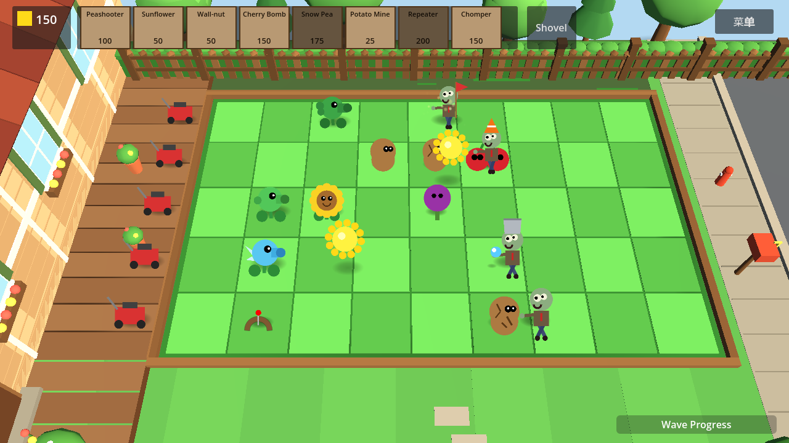
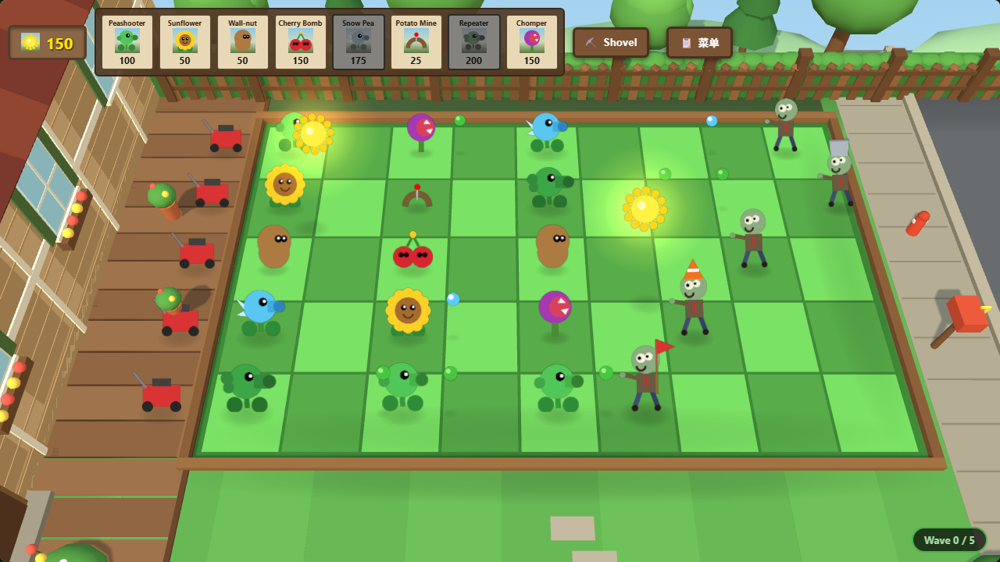

# Plants vs Zombies — 3D 渲染的 2D 游戏 (HD-2D / 2.5D)

**引擎**: Godot Engine 4.7.2 + Three.js (WebGL2)
**玩法**: 2D 植物大战僵尸（5×9 草坪、波次、阳光经济、8 植物 / 4 僵尸 / 3 关卡，全部保留原版数值与规则）
**渲染**: 3D（透视相机 + 立体草坪场景 + 2D 美术立牌 billboard + 3D 粒子特效）
**目标平台**: 纯 Web 前端（Godot Web 导出 / 浏览器即时预览）

> 本项目在原 2D 版基础上做了「3D 渲染 2D」的改造：**游戏逻辑仍然是 2D**（像素坐标、网格、车道、数值全部不变），
> **渲染层换成 3D**：固定透视相机俯瞰一座立体草坪 diorama，植物、僵尸、子弹、阳光以面向相机的 2D 美术立牌
> （billboard，HD-2D 风格）站在草地上，配合 3D 场景道具、光照与地面软阴影。原有程序化 2D 美术被离线烘焙成
> 透明 sprite sheet 供两个版本共用，因此 **Godot 版和网页版视觉一致、玩法一致**。

| Godot 版 | 网页版 (Three.js) |
| --- | --- |
|  |  |

---

## 🌟 核心特性

### 1. 3D 渲染 + 2D 玩法（HD-2D / 2.5D）

- **固定透视相机**：58° 俯角、40° 垂直 FOV，从斜上方俯瞰草坪，近大远小、有真实透视深度感；相机固定保证操作（种植、铲除、点阳光）稳定可读。
- **立体草坪场景（3D diorama）**：5×9 棋盘草坪 + 木框草坪边、左侧木地板露台与 3D 房屋立面（门/窗/屋顶）、右侧人行道与街道、
  后排木栅栏 + 绿篱 + 低多边形树木、远景花丛与草坪边缘细节，全部由 3D 图元按调色板程序化搭建。
- **2D 美术立牌**：植物 / 僵尸 / 豌豆 / 阳光 / 小推车都是取自原 2D 程序化美术的透明 sprite，作为始终面向相机的 billboard
  站立在草坪上；每类单位带地面软阴影（blob shadow），僵尸行走、植物摇摆、阳光旋转等均为逐帧动画。
- **3D 特效与反馈**：豌豆击中溅射（3D 粒子）、樱桃炸弹爆炸（粒子爆发 + 扩散光环）、铁桶/路障僵尸破甲时掉落 3D 帽子、
  寒冰减速染色、受击闪白、僵尸倒地淡出、阳光飞向 HUD 计数器等。
- **2D 系统零改动**：GridManager（5×9 网格）、阳光经济、波次/关卡数据、僵尸护甲/减速/啃食、小推车、胜负判定全部沿用原 2D 逻辑，
  数据仍由 `data/` 下的 `.tres` 资源驱动。

### 2. 统一的「2D 像素 ↔ 3D 世界」坐标契约

两个渲染端使用同一套换算，保证点击/悬停/特效位置一致：

```text
PX    = 1/45                 # 世界单位 / 游戏像素
世界   = ((game_x - 640) * PX, height_px * PX, (game_y - 360) * PX)
地面   = 世界 Y = 0
```

Godot 端用 `WorldRoot` 技巧：`position = (-640·PX, 0, -360·PX)`、`scale = (PX,PX,PX)`，
其子节点直接沿用**游戏像素坐标**（`position = Vector3(game_x, height_px, game_y)`），
所以全部玩法代码继续按 px/秒 移动、按像素常量判断，无需在逻辑里做任何换算。

### 3. 离线烘焙的 Billboard 资源管线（两版本共享同一套美术）

- `tools/billboard_factory.gd` 在无头/隐身窗口下加载原有 2D 程序化美术脚本（`scripts/visuals/*_visuals.gd`），
  渲染每一类单位的动画帧，打包成横向 sprite sheet（256×256/帧，RGBA 透明）并输出 `assets/billboards/manifest.json`
  （帧数、fps、锚点、包围盒）。
- Godot 版 `BillboardLibrary` 直接加载这些 PNG（Sprite3D）；网页版由 `tools/build_web_assets.mjs` 把同一批 PNG
  转成内嵌 base64 的 ES module（`web_preview/billboard_assets.js`），因此**无需任何外部美术资源、离线可玩**。
- 新增/修改美术只需重跑烘焙工具（见下文「重新烘焙美术」）。

### 4. 高度解耦与数据驱动（沿用原架构）

- 植物/僵尸/关卡全部是自定义 `Resource`（`PlantData` / `ZombieData` / `LevelData`），新单位只需新增 `.tres` 并在关卡里引用。
- `EventBus` 全局信号总线解耦种植、阳光、波次、受击、胜负。
- `GameManager` 状态机与阳光交易事务；`SoundManager` 程序化合成全部音效（零外部音频资源）。

### 5. 双重运行模式

- **网页即时预览（推荐试玩）**：`web_preview/index.html` 使用 Three.js r170（本地 vendored）渲染同一套 3D 画面，
  打开即玩，无需安装 Godot。
- **Godot 4.7.2 原生项目**：用 Godot 打开 `project.godot` 按 F5 即可游玩/编辑/导出为 Web。

---

## 📁 目录结构（3D 改造后）

```text
pvz_like_game/
├── project.godot                     # Godot 配置（GL Compatibility / Web 友好）
├── export_presets.cfg                # Web 导出预设
├── serve.py                          # 本地 Web 服务器（COOP/COEP 头，供 web_preview / Godot Web 导出）
├── README.md
├── assets/
│   └── billboards/                   # ★ 烘焙好的 billboard 资源（由 tools/billboard_factory 生成）
│       ├── manifest.json             #   帧数/fps/锚点/包围盒 元数据
│       ├── p_*.png  z_*.png  i_*.png #   横向 sprite sheet（透明背景）
├── docs/
│   ├── 3d-render-spec.md             # 3D 改造技术规范（坐标/相机/资源/架构/验收）
│   ├── billboards_contact.png        # billboard 美术资源速览
│   └── screenshots/                  # 最终效果截图
├── data/                             # 数据驱动资源（与原版一致）
│   ├── plants/  zombies/  levels/    # 8 植物 / 4 僵尸 / 3 关卡
├── scenes/
│   ├── main_menu.tscn                # 主界面/关卡选择（2D UI，未改动）
│   ├── main.tscn                     # ★ 3D 战斗场景：Environment / DirectionalLight / Camera3D /
│   │                                 #   WorldRoot（Board、GridManager、SunManager、WaveManager、LawnMowers）+ HUD
│   ├── ui/                           # HUD 卡槽/阳光/铲子/波次条（CanvasLayer，2D UI 未改动）
│   ├── plants/ zombies/ projectiles/ items/ effects/   # ★ 全部改为 Area3D + Billboard2D 立牌
├── scripts/
│   ├── main.gd                       # Node3D 场景入口：相机/WorldRoot/搭建立体场景/关卡初始化
│   ├── core/
│   │   ├── world_space.gd            # ★ 2D 像素 ↔ 3D 世界坐标契约 + 屏幕→地面射线换算
│   │   ├── board_builder.gd          # ★ 程序化搭建 3D diorama（草坪/露台/房屋/街道/树木/花丛）
│   │   ├── grid_manager.gd           # 悬停高亮/虚影预览/种植铲除/阳光点选
│   │   ├── sun_manager.gd  wave_manager.gd
│   ├── visuals/
│   │   ├── billboard2d.gd            # ★ 面向相机的 billboard 节点（逐帧动画 + 色调控制）
│   │   ├── billboard_library.gd      # ★ sheet/manifest 加载、实例化、软阴影、幽灵预览
│   │   ├── plant_visuals.gd  zombie_visuals.gd  item_visuals.gd   # 原 2D 程序化美术（烘焙用，运行时不再直接绘制）
│   ├── plants/ zombies/ projectiles/ items/ effects/   # ★ 玩法逻辑（3D 位置、仍按 px/秒）
│   ├── autoload/                     # EventBus / SoundManager / GameManager
│   └── resources/                    # PlantData / ZombieData / LevelData
├── tools/
│   ├── billboard_factory.gd/.tscn    # 美术烘焙工具（离线生成 assets/billboards）
│   ├── build_web_assets.mjs          # 生成 web_preview/billboard_assets.js
│   ├── preview_billboards.gd/.tscn   # 3D diorama 预览/验证场景（Lead 参考场景）
│   └── verify/                       # 独立验证工具（Playwright 截图、Godot 截图/逻辑冒烟测试）
└── web_preview/
    ├── index.html                    # ★ Three.js 3D 网页预览（DOM HUD/菜单 + 3D 场景）
    ├── three.module.min.js           #   vendored Three.js r170（本地依赖、无 CDN）
    └── billboard_assets.js           #   billboard 资源（base64 内嵌，由 tools/build_web_assets.mjs 生成）
```

---

## 🚀 启动与体验指南

### 方式一：浏览器即时预览（无需安装 Godot）

```bash
# 在项目根目录启动自带 Web 服务器
python3 serve.py 8080
```

打开 👉 **http://localhost:8080/web_preview/**

- 选择关卡 → 3D 草坪场景；点击顶部卡牌选择植物，再点击草坪格子种植；点击掉落的阳光收集；
  右侧铲子/菜单按钮等与原版一致。
- 说明：页面使用 ES module（Three.js 本地模块）加载，必须通过 HTTP 服务访问，**不能直接双击 `index.html`（file://）打开**。

### 方式二：Godot 4.7.2 引擎中打开与编辑

1. 用 **Godot 4.7.2** 导入本目录下的 `project.godot`。
2. 按 **F5**（主场景为 `scenes/main_menu.tscn`）选择关卡即可进入 3D 战斗场景。
3. 3D 场景结构：`scenes/main.tscn`（`Main` Node3D）；立体草坪由 `scripts/core/board_builder.gd` 在运行时程序化搭建。

### 方式三：导出为纯 Web 前端应用（HTML5 / WebAssembly）

1. Godot 4.7.2 中 **Project → Export…**，选择已内置的 **Web** 预设（`export_presets.cfg`）。
2. 使用 **GL Compatibility** 渲染模式（已预配置），导出到 `web_export/`。
3. `python3 serve.py 8080` 后访问 `http://localhost:8080/web_export/`。

> 💡 浏览器运行 Godot Web 需要跨源隔离头：`Cross-Origin-Opener-Policy: same-origin` 与
> `Cross-Origin-Embedder-Policy: require-corp`；随附的 `serve.py` 已预置，可直接使用。

---

## 🧭 3D 渲染实现要点

1. **相机**：`Camera3D`，FOV 40°、俯角 58°、距离 23（世界单位），看向草坪中心；固定机位。Godot 中由
   `WorldSpace.default_camera_position()` 计算，网页版使用相同数值。
2. **坐标**：见上文「统一的坐标契约」；`WorldSpace`（Godot）/ `worldOf()`（Web）负责换算。
3. **Billboard**：`Billboard2D`（Godot `Node3D` + 子 `Sprite3D(billboard)`；Web `THREE.Sprite`）的节点原点即
   立牌锚点（脚底/漂浮物中心），读取 manifest 的锚点自动对齐地面/中心，按帧率播放 sprite sheet 动画。
4. **点击/悬停**：屏幕点 → 相机射线与地面 Y=0 求交 → 游戏像素坐标 → 原 GridManager 网格逻辑；
   阳光用「3D 位置投影到屏幕后的像素距离」点选（Godot）／屏幕投影后的精灵位置（Web）。
5. **3D 特效**：豌豆溅射/樱桃爆炸使用 3D 粒子 + 扩散光环（Godot 用 Sprite3D 粒子规避 `CPUParticles3D`
   在缩放父节点下的尺度问题）；破甲掉落 3D 帽子；僵尸死亡淡出/压扁。
6. **UI**：HUD/菜单保持原 2D UI（Godot `CanvasLayer` / Web DOM），叠加在 3D 画面之上，未改布局与交互。

---

## 🔁 重新烘焙美术 / 重建网页资源（可选）

美术资源已提交在 `assets/billboards/`，正常游玩无需重建；修改 2D 程序化美术或新增单位后：

```bash
# 1) 重新烘焙 billboard sprite sheet + manifest（需要 Godot 4.7.2；会打开窗口渲染后自动退出）
godot --path . res://tools/billboard_factory.tscn

# 2) 重新生成网页版内嵌资源（需要 Node.js ≥ 18）
node tools/build_web_assets.mjs
```

新增一种植物/僵尸并复用它作为 3D 立牌的步骤：

1. 在 `data/plants/`（或 `zombies/`）新增 `PlantData` 资源，绑定新场景；
2. 在 `scenes/plants/` 新增对应 `Area3D` 实体场景 + 脚本（参考现有植物），脚本里指定 billboard sheet 名；
3. 在 `scripts/visuals/plant_visuals.gd` 增加对应 2D 程序化美术（`_draw_xxx()`），并把它加入
   `tools/billboard_factory.gd` 的烘焙任务表与 `BillboardLibrary.PLANT_SHEETS` 映射；
4. 重新运行上面的烘焙/生成命令，把新 `.tres` 加入关卡 `available_plants` 即可。

---

## 🧪 验证与测试

`tools/verify/` 下提供一套独立验证工具（不依赖游戏白盒逻辑，靠真实输入/引擎 API 驱动）：

| 工具 | 作用 |
| --- | --- |
| `tools/verify/web_shot.mjs` + `cdp.mjs` | 通过 CDP 驱动无头浏览器打开网页预览：等待 `window.__pvzReady`、断言 `window.__pvzErrors`/console/页面异常为空、截图（`shot/menu/pause/baseline2d` 模式、`--level N`） |
| `tools/verify/web_interact.mjs` | 网页版 E2E：菜单→关卡、卡牌+画布点击种植（格子/阳光/冷却/HUD）、投影阳光点击收集、8 种植物、铲子、弹道伤害、小推车、暂停、胜负弹窗、重开、关卡 2/3 |
| `tools/verify/capture_godot.gd/.tscn` + `godot_shot.sh` | 加载 `scenes/main.tscn`，用真实 API 种植/刷怪/放阳光后保存视口截图（`--setup empty/plants/zombies/suns/gameplay/pause` 等 8 种） |
| `tools/verify/smoke_logic.gd/.tscn` + `godot_smoke.sh` | Godot headless 逻辑冒烟测试：种植/扣阳光/占位/阳光不足、自然落阳与投影点击收集、波次推进、僵尸行走/被豌豆击杀、啃食、小推车、HUD 暂停/继续、胜负面板（34 条断言，30s 模拟） |

**当前验收结果**（详见 [`tools/verify/QA_REPORT.md`](tools/verify/QA_REPORT.md)，最终结论 **PASS**，无阻断缺陷）：

- Godot headless 逻辑/流程冒烟：**34/34 PASS**（1802 帧 ≈30s 模拟，日志干净）；10/10 截图场景通过（0 SCRIPT ERROR）。
- Godot 渲染像素级视觉检查：**5/5 PASS**（寒冰染色、路障破甲前后像素差异均可见且状态正确）。
- 网页版 E2E：**26/26 PASS**，0 错误/异常/404；菜单、暂停、胜负、关卡 2/3、真实点击种植/收阳光/铲子/小推车全部覆盖。
- 网页版渲染帧率（无头 WARP 软件 GPU，1280x720）：**~52 fps**，满足验收标准。
- 两个版本各自的开发期自测（交互 53/53、流程 16/16、实体集成 34/34、数值/行为对照 42/42、网格生命周期 10/10）见 QA 报告附录。

> 本仓库的验证在 WSL2 + 软件渲染（llvmpipe/GL Compatibility）下进行：方向光阴影贴图在该软件栈不生效
> （`shader_gles3.cpp:802` 环境限制），截图中的“落地感”由每单位地面软阴影（blob shadow）保证；这不影响真实 GPU。

---

## 🕹️ 游戏核心系统（与原版一致）

- **草坪网格**：5 行 × 9 列；悬停高亮、植物虚影预览、右键取消、铲子移除。
- **阳光经济**：自然落阳 + 向日葵产阳；点击收集后飞向 HUD 计数器。
- **卡牌/冷却**：按关卡 `available_plants` 动态生成卡槽，阳光不足变暗，种植后冷却扫描。
- **僵尸**：4 种（普通/路障/铁桶/旗帜），独立护甲、破甲掉落、寒冰减速 5s、啃食、死亡；房屋到达判负。
- **植物**：豌豆射手 / 向日葵 / 坚果墙（三阶段裂纹）/ 樱桃炸弹（3×3）/ 寒冰射手 / 土豆雷（14s 武装）/
  双发射手 / 大嘴花（吞食咀嚼）。
- **小推车**：每行一辆，僵尸逼近时自动触发冲刷整行。
- **波次/关卡**：3 关，旗帜大波提示、波次进度条、胜利/失败结算、暂停/重开/返回菜单。

---

## 🧩 数据资源速查

| 植物 | 阳光 | 冷却 | 说明 |
| --- | --- | --- | --- |
| Peashooter 豌豆射手 | 100 | 7.5s | 直线豌豆 20 伤害 |
| Sunflower 向日葵 | 50 | — | 每 24s 产 25 阳光 |
| Wall-nut 坚果墙 | 50 | — | 4000 血，三段裂纹 |
| Cherry Bomb 樱桃炸弹 | 150 | — | 3×3 范围 1800 伤害 |
| Snow Pea 寒冰射手 | 175 | — | 减速 50%，持续 5s |
| Potato Mine 土豆雷 | 25 | — | 14s 武装，触碰秒杀 |
| Repeater 双发射手 | 200 | — | 连发两枚豌豆 |
| Chomper 大嘴花 | 150 | — | 吞食僵尸后咀嚼 30s |

| 僵尸 | 血量 | 特点 |
| --- | --- | --- |
| Normal 普通 | 200 | 基础 |
| Conehead 路障 | 200 + 370 护甲 | 破甲掉落路障 |
| Buckethead 铁桶 | 200 + 1100 护甲 | 极高防御，破甲掉落铁桶 |
| Flag 旗帜 | 200 | 移速 ×1.25，引领大波 |

| 关卡 | 波次 | 特点 |
| --- | --- | --- |
| 1 前院草坪 | 5 | 入门阶梯波次 |
| 2 夜幕突袭 | 6 | 路障/铁桶夹攻 |
| 3 尸潮狂欢 | 7 | 铁桶大军终极围攻 |

---

## ⚠️ 已知限制 / 环境说明

- **网页预览需要本地 HTTP 服务**：页面使用 ES module 与 WebGL2，请通过 `python3 serve.py 8080` 访问
  `http://localhost:8080/web_preview/`（直接 file:// 打开会因浏览器模块/跨域策略失败）；需要浏览器支持 WebGL2，
  不支持时会显示明确的错误面板而不是白屏。
- **Godot Web 导出**需要在本机安装 Godot 4.7.2 的 Web 导出模板（引擎本身不含模板）；导出后同样用 `serve.py` 提供 COOP/COEP 头。
- **软件渲染环境**（如无 GPU 的 CI/WSL2 llvmpipe）：3D 场景可运行但较慢（约 18–25 ms/帧），且方向光阴影贴图不生效；
  真实 GPU 上 3D 场景为 60fps 级别。网页版在集成/软件 GPU 上（WARP）约 50fps。
- 3D 渲染风格为 **HD-2D/2.5D**：角色与植物是面向相机的 2D 立牌（billboard），不是 3D 建模；玩法与数值与原 2D 版一致。

---

## 设计文档

完整技术契约见 [`docs/3d-render-spec.md`](docs/3d-render-spec.md)：坐标/相机契约、billboard 资源 schema、
Godot 3D 场景架构与实体契约、网页版 Three.js 架构、验证命令与验收清单。
